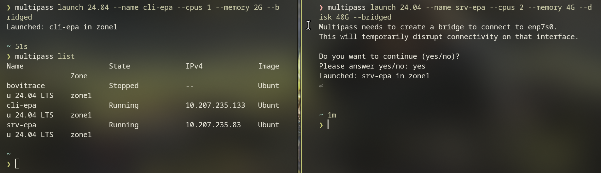
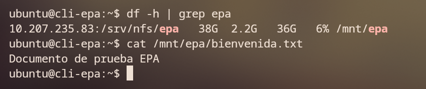
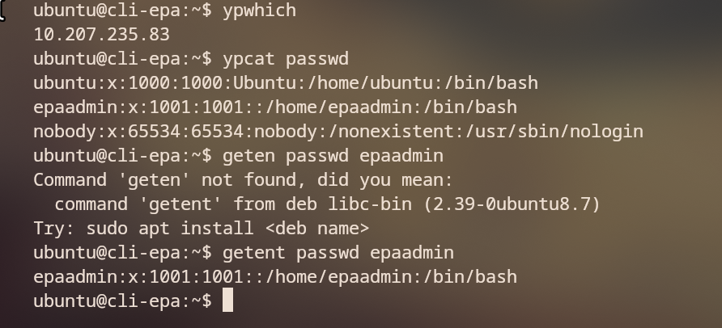
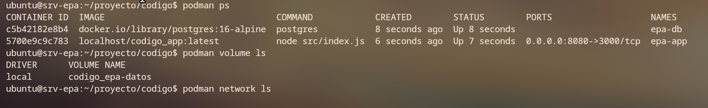
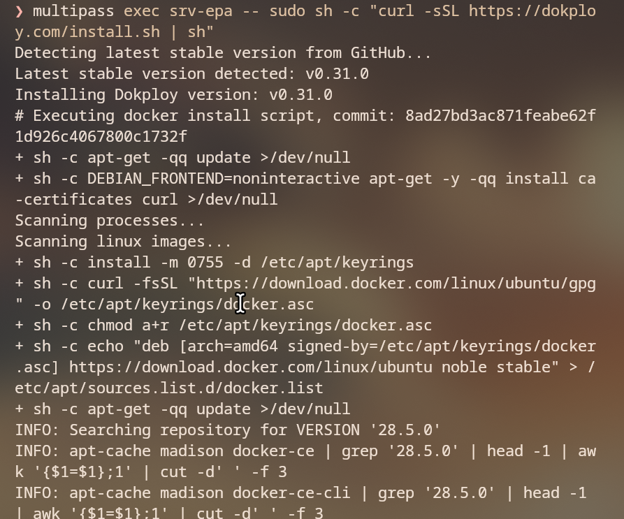
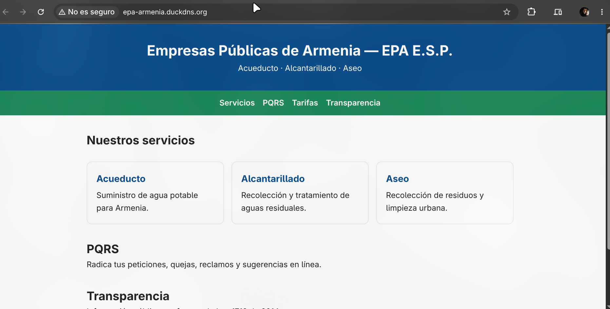
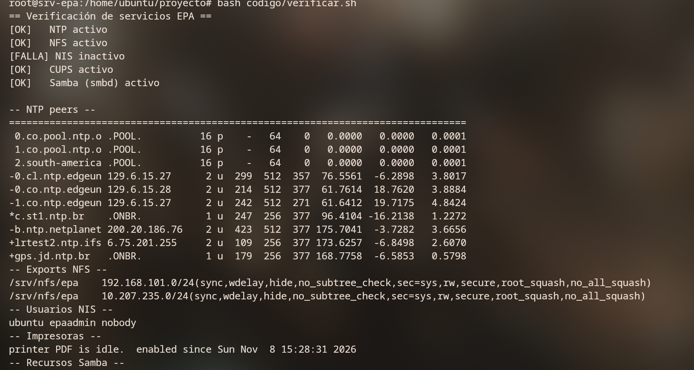
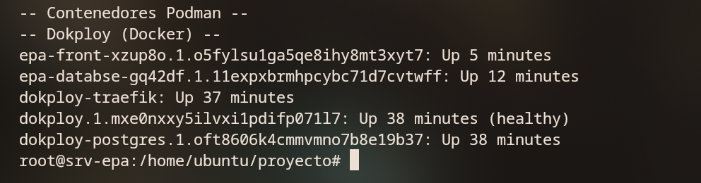
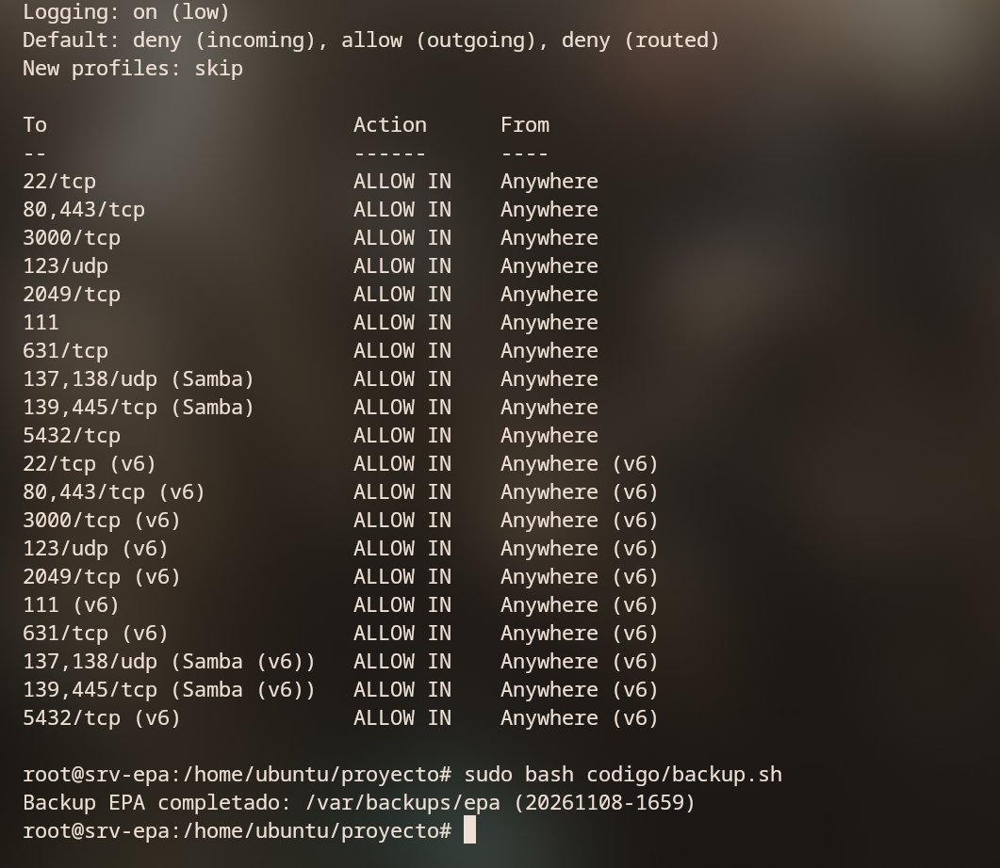

# Evidencias de Funcionamiento — Infraestructura de TI de EPA E.S.P.

**Universidad del Quindío** — Facultad de Ingeniería de Sistemas y Computación
**Programa:** Ingeniería de Sistemas y Computación
**Curso:** Administración de Infraestructura de TI
**Docente:** Maycol Cárdenas Acevedo
**Estudiante:** Manuel Pineda Varela
**Empresa objeto de estudio:** Empresas Públicas de Armenia E.S.P. (EPA)
**Fecha de entrega:** 8 de noviembre de 2026

---

Este documento reúne las evidencias gráficas de cada servicio implementado y verificado,
organizadas por fase. Las imágenes originales también se conservan en `capturas/fase1`…`fase6`.

---

## Fase 1 — Virtualización con Multipass

### 1.1 Versión de Multipass e interfaces de red

Multipass **1.17.0** instalado; interfaz física `enp7s0` disponible para el modo *bridged*.

### 1.2 Máquinas virtuales creadas

VMs `srv-epa` (servidor) y `cli-epa` (cliente) en estado **Running**.

### 1.3 IP fija y hostname del servidor

Hostname `srv-epa`; interfaz `eth1` con IP fija **192.168.101.100/24** (LAN) y `eth0`
en la red privada de Multipass.

---

## Fase 2 — Servicios Linux

### 2.1 NTP — Sincronización de tiempo

Servidor NTP (ntpsec) sincronizado; el peer `*gps.jd.ntp.br` aparece seleccionado y se
emplean los pools de Colombia/Sudamérica.

### 2.2 NFS — Compartición de archivos (cliente)

`cli-epa` monta `10.207.235.83:/srv/nfs/epa` en `/mnt/epa` y lee el archivo compartido.

### 2.3 NIS — Autenticación centralizada (servidor)

`ypcat passwd` y `getent passwd epaadmin` en el servidor: el usuario centralizado
`epaadmin` está publicado en el dominio `epa.local`.

### 2.4 NIS — Autenticación centralizada (cliente)

`cli-epa` enlaza al servidor (`ypwhich` → `10.207.235.83`) y resuelve por NIS al usuario
`epaadmin`, que **no existe localmente** → prueba de autenticación centralizada.

### 2.5 CUPS — Impresión

Panel web de CUPS 2.4.7 accesible en `https://192.168.101.100:631`; cola de impresión
`PDF` configurada.

### 2.6 Samba — Compartición para Windows/Mac

Recurso `epa` (`/srv/samba/epa`) visible y accesible con el usuario `epauser`; el recurso
aparece en el listado `smbclient -L`.

---

## Fase 3 — Contenedores con Podman

### 3.1 Contenedores y volumen

`epa-app` (puerto 8080→3000) y `epa-db` (PostgreSQL) en ejecución; volumen
`codigo_epa-datos` para la persistencia.

### 3.2 Red de contenedores

Red `codigo_epa-net` que conecta la aplicación con la base de datos.

### 3.3 Aplicación y base de datos conectadas

El portal responde en `:8080`, `/health` devuelve el estado y `/api/estado-bd` confirma
`{"bd":"conectada"}` → app + PostgreSQL funcionando en Podman.

---

## Fase 4 — Despliegue con Dokploy (PaaS)

### 4.1 Instalación de Dokploy

Instalación de Dokploy **v0.31.0** sobre la VM servidor.

### 4.2 Proyecto desplegado

Aplicación `front` (portal EPA) y base de datos `databse` (PostgreSQL) desplegadas y
activas (indicadores en verde).

### 4.3 Portal institucional publicado

Sitio institucional de EPA servido en `epa-armenia.duckdns.org`.

### 4.4 Endpoint de estado (JSON)

`/health` devuelve el estado del servicio en formato JSON.

### 4.5 Conexión a la base de datos

`/api/estado-bd` confirma la conexión a PostgreSQL (`{"bd":"conectada"}`).

---

## Fase 5 — Verificación integral y extras

### 5.1 Chequeo de servicios (parte 1)

`verificar.sh`: NTP, NFS, CUPS y Samba activos; peers NTP, exports NFS
(ambas subredes), usuarios NIS (`ubuntu epaadmin nobody`) e impresora `PDF`.

> Nota: la versión de la captura marcaba «NIS inactivo» porque el script consultaba el
> servicio `nis`; en Ubuntu 24.04 son `ypserv`/`ypbind`. El script ya fue corregido y los
> usuarios NIS listados en la misma captura confirman que el servicio opera correctamente.

### 5.2 Chequeo de servicios (parte 2)

Contenedores de Podman y de Dokploy (Traefik, app, bases de datos) en ejecución.

### 5.3 Firewall (UFW) y respaldo automático

Reglas de UFW con solo los puertos de los servicios y respaldo generado por `backup.sh`
(puntos extra).

---

## Resumen de cumplimiento

| Servicio | Evidencia | Estado |
|---|---|---|
| Multipass (VMs) | 1.1–1.3 | ✅ |
| NTP | 2.1 | ✅ |
| NFS | 2.2 | ✅ |
| NIS | 2.3–2.4 | ✅ |
| CUPS | 2.5 | ✅ |
| Samba | 2.6 | ✅ |
| Podman (app + BD) | 3.1–3.3 | ✅ |
| Dokploy + Web + BD | 4.1–4.5 | ✅ |
| Firewall + Backup (extra) | 5.3 | ✅ |
