# Documentación Técnica — Infraestructura de TI de EPA E.S.P.

**Universidad del Quindío** — Facultad de Ingeniería de Sistemas y Computación
**Programa:** Ingeniería de Sistemas y Computación
**Curso:** Administración de Infraestructura de TI
**Docente:** Maycol Cárdenas Acevedo
**Estudiante:** Manuel Pineda Varela
**Empresa objeto de estudio:** Empresas Públicas de Armenia E.S.P. (EPA)
**Fecha de entrega:** 8 de noviembre de 2026

**Parámetros técnicos:** servidor `srv-epa` · `192.168.101.100` · Ubuntu Server 24.04 LTS ·
red `192.168.101.0/24` · dominio NIS `epa.local` · dominio web `epa-armenia.duckdns.org`.

> Los archivos de configuración completos se encuentran en [`codigo/`](codigo/). El presente
> documento describe el procedimiento de instalación, los comandos de verificación y la
> solución de problemas de cada servicio. Las capturas de pantalla se depositan en
> [`capturas/`](capturas/) con el nombre indicado en cada sección.

---

## 0. Preparación de la máquina virtual (Multipass)

Se usa **Multipass** (Canonical) como hipervisor. Ventajas: la VM se crea en un comando,
se monta la carpeta del proyecto directamente y el cliente de pruebas es otra VM igual de
simple.

### 0.1 Crear el servidor

En el host (tu PC), con la red **bridged** para que la VM sea visible en `192.168.101.0/24`:

```bash
# Averigua tu interfaz de red del host (ethernet o wifi) y fíjala como puente:
multipass networks
multipass set local.bridged-network=<tu_interfaz>     # ej: enp3s0 o wlan0

# Crear el servidor (bridged + recursos del proyecto):
multipass launch 24.04 --name srv-epa --cpus 2 --memory 4G --disk 40G --bridged

# Entrar a la VM:
multipass shell srv-epa
```

> El usuario por defecto dentro de la VM es `ubuntu`. Para `sudo` no pide clave.

### 0.2 Montar la carpeta del proyecto (así copias los configs sin esfuerzo)

Desde el host, **fuera** de la VM:

```bash
multipass mount "/home/ing69cooler/Documentos/Manuel/Semestre VII/Ingenieria/Admin_ti/Proyecto_final_admin_ti" srv-epa:/home/ubuntu/proyecto
```

Ahora dentro de la VM tienes todo en `/home/ubuntu/proyecto` (incluida la carpeta
`codigo/`). En las secciones siguientes, los `sudo cp codigo/...` se corren desde
`/home/ubuntu/proyecto`.

### 0.3 IP fija y hostname

La interfaz bridged dentro de la VM en esta VM es `eth1` (confírmalo con `ip a`). Edita
[`codigo/01-netcfg.yaml`](codigo/01-netcfg.yaml) si el nombre difiere, y aplícalo:

```bash
cd /home/ubuntu/proyecto
sudo cp codigo/01-netcfg.yaml /etc/netplan/99-static.yaml
sudo chmod 600 /etc/netplan/99-static.yaml
sudo netplan apply
sudo hostnamectl set-hostname srv-epa
sudo apt update && sudo apt upgrade -y
```

**Verificación:** `ip a` muestra `192.168.101.100`; `hostname` muestra `srv-epa`.
**Evidencia:**

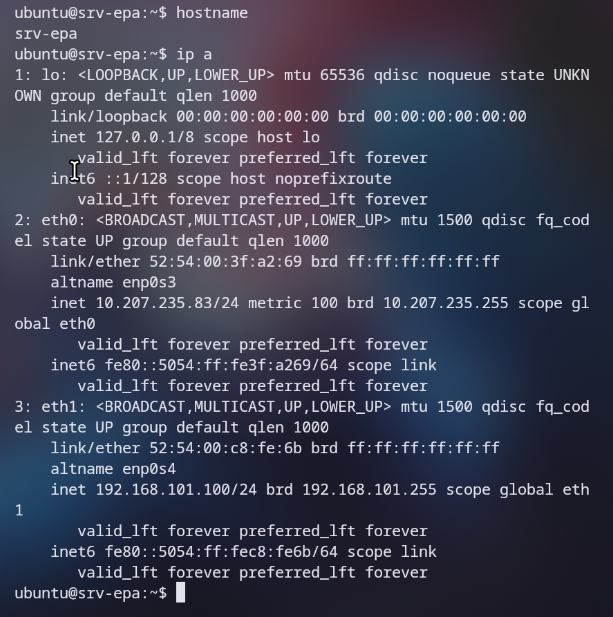

### 0.4 Cliente para las pruebas (NFS, NIS, Samba)

Crea una segunda VM, también bridged, que hará de cliente:

```bash
multipass launch 24.04 --name cli-epa --cpus 1 --memory 2G --bridged
multipass shell cli-epa
```

Asígnale también IP fija en la LAN con [`codigo/01-netcfg-cliente.yaml`](codigo/01-netcfg-cliente.yaml)
(`192.168.101.101`), de forma análoga al servidor.

> **Nota de red (dos redes).** En Multipass, dos VMs en modo *bridged* conectadas al mismo
> adaptador físico **no se comunican entre sí por TCP** (el ping ICMP sí pasa; es una
> limitación del hipervisor, tipo macvtap/VEPA). Por ello el diseño emplea dos redes:
> - **LAN `192.168.101.0/24`** (bridged): portal web, Dokploy y acceso desde el host. El
>   servidor es `192.168.101.100`.
> - **Red privada de Multipass `10.207.235.0/24`**: comunicación entre `srv-epa`
>   (`10.207.235.83`) y `cli-epa` (`10.207.235.133`) para NFS, NIS y Samba.
>
> Los servicios autorizan ambas subredes; el cliente monta y se autentica por la IP privada
> del servidor. Confirma las IPs privadas con `multipass list` (pueden variar).

---

## 1. NTP — Sincronización de tiempo

**Objetivo:** que todos los equipos de EPA compartan la misma hora para facturación y auditoría.

### Instalación (servidor)

> En Ubuntu 24.04 el paquete `ntp` instala **ntpsec**; su configuración reside en
> `/etc/ntpsec/ntp.conf` y el servicio se llama `ntpsec`.

```bash
cd /home/ubuntu/proyecto
sudo apt install ntp -y
sudo cp codigo/ntp.conf /etc/ntpsec/ntp.conf
sudo systemctl restart ntpsec
```

El archivo [`codigo/ntp.conf`](codigo/ntp.conf) usa los pools de Colombia
(`co.pool.ntp.org`) y autoriza a la red `192.168.101.0/24` a sincronizar.

### Verificación

```bash
# En el servidor: debe listar los peers con un '*' en el seleccionado
ntpq -p
# En un cliente Linux:
sudo apt install ntpdate -y
sudo ntpdate 192.168.101.100
timedatectl   # "System clock synchronized: yes"
```

**Evidencia:**

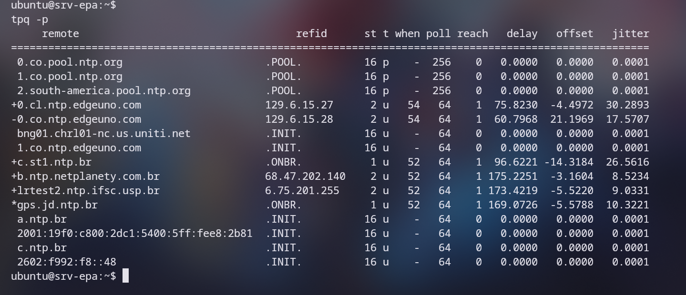

### Solución de problemas

- **`ntpq -p` sin peers:** abrir el puerto UDP 123 (`sudo ufw allow 123/udp`) y verificar salida a internet.
- **El cliente no sincroniza:** confirmar que `restrict 192.168.101.0 mask 255.255.255.0` está en `/etc/ntpsec/ntp.conf`.
- **`cp` falla con «No such file»:** ejecutar primero `cd /home/ubuntu/proyecto` (ahí está la carpeta `codigo/` montada).

---

## 2. NFS — Compartición de archivos (Linux)

**Objetivo:** repositorio común de planos y actas montado por las estaciones Linux.

### Servidor

```bash
sudo apt install nfs-kernel-server -y
sudo mkdir -p /srv/nfs/epa
sudo chown nobody:nogroup /srv/nfs/epa
sudo cp codigo/exports /etc/exports
sudo exportfs -ra
sudo systemctl enable --now nfs-kernel-server
```

[`codigo/exports`](codigo/exports) comparte `/srv/nfs/epa` a `192.168.101.0/24` con
`rw,sync,no_subtree_check`.

### Cliente Linux

```bash
sudo apt install nfs-common -y
sudo mkdir -p /mnt/epa
sudo mount -t nfs 10.207.235.83:/srv/nfs/epa /mnt/epa   # IP privada del servidor
# Montaje permanente:
echo "192.168.101.100:/srv/nfs/epa  /mnt/epa  nfs  defaults  0  0" | sudo tee -a /etc/fstab
```

### Verificación

```bash
# Servidor:
sudo exportfs -v
# Cliente:
df -h | grep epa
echo "prueba" | sudo tee /mnt/epa/test.txt   # debe escribirse y verse en el servidor
```

**Evidencia:**

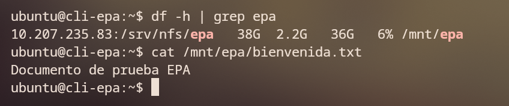

### Solución de problemas

- **`access denied`:** la IP del cliente no está en el rango de `exports`; revisar y `exportfs -ra`.
- **`permission denied` al escribir:** revisar permisos de `/srv/nfs/epa` (`chmod 0777` o grupo adecuado).

---

## 3. NIS — Autenticación centralizada

**Objetivo:** un solo usuario/clave por empleado para todos los equipos (dominio `epa.local`).

> **Importante (Ubuntu 24.04):** el dominio NIS se guarda en `/etc/defaultdomain` y debe
> contener exactamente `epa.local` (no `NISDOMAIN=...`). Ejecuta los comandos de a uno.

### Servidor

```bash
echo "nis nis/domain string epa.local" | sudo debconf-set-selections
sudo DEBIAN_FRONTEND=noninteractive apt install nis -y
printf "epa.local\n" | sudo tee /etc/defaultdomain
sudo nisdomainname epa.local
sudo sed -i 's/^NISSERVER=.*/NISSERVER=master/' /etc/default/nis
sudo cp codigo/yp.conf.server /etc/yp.conf
# Autorizar las redes en securenets:
sudo tee /etc/ypserv.securenets >/dev/null <<EOF
255.0.0.0       127.0.0.0
255.255.255.0   192.168.101.0
255.255.255.0   10.207.235.0
EOF
sudo /usr/lib/yp/ypinit -m       # Ctrl+D para terminar la lista, luego 'y'
# Usuario centralizado de prueba + regenerar mapas:
sudo useradd -m -s /bin/bash epaadmin && echo "epaadmin:EpaClave123" | sudo chpasswd
cd /var/yp && sudo make && cd -
sudo systemctl enable --now ypserv ypbind
```

### Cliente Linux

```bash
echo "nis nis/domain string epa.local" | sudo debconf-set-selections
sudo DEBIAN_FRONTEND=noninteractive apt install nis -y
printf "epa.local\n" | sudo tee /etc/defaultdomain
sudo nisdomainname epa.local
sudo cp codigo/yp.conf.client /etc/yp.conf    # apunta a 10.207.235.83 (red privada)
sudo sed -i 's/^passwd:.*/passwd:         files nis/' /etc/nsswitch.conf
sudo sed -i 's/^group:.*/group:          files nis/'  /etc/nsswitch.conf
sudo sed -i 's/^shadow:.*/shadow:         files nis/' /etc/nsswitch.conf
sudo systemctl restart ypbind
```

### Verificación

```bash
ypwhich                 # servidor: 127.0.0.1 · cliente: 10.207.235.83
ypcat passwd            # lista los usuarios NIS (incluye epaadmin)
getent passwd epaadmin  # el usuario NIS aparece en el cliente (prueba de auth centralizada)
```

**Evidencia:** servidor y cliente.

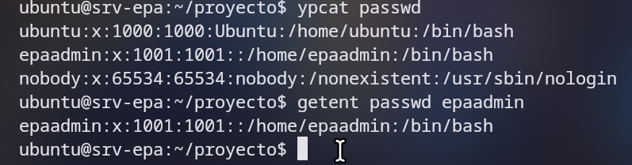

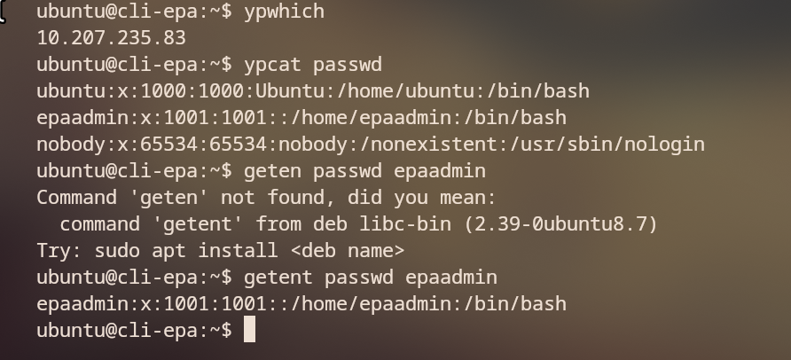

### Solución de problemas

- **`ypwhich: Domain not bound`:** `/etc/defaultdomain` quedó vacío. Corrige con
  `printf "epa.local\n" | sudo tee /etc/defaultdomain`, `sudo nisdomainname epa.local`,
  `sudo systemctl restart ypbind`.
- **El cliente no enlaza:** revisar que `10.207.235.0/24` esté en `/etc/ypserv.securenets` del servidor.
- **El usuario no aparece:** regenerar mapas en el servidor con `cd /var/yp && sudo make`.

---

## 4. CUPS — Impresión compartida

**Objetivo:** cola central para imprimir facturas y reportes.

### Servidor

```bash
sudo apt install cups -y
sudo usermod -aG lpadmin $USER
sudo cp codigo/cupsd.conf /etc/cups/cupsd.conf
sudo systemctl enable --now cups
sudo systemctl restart cups
```

[`codigo/cupsd.conf`](codigo/cupsd.conf) habilita `Listen 0.0.0.0:631` y permite el
acceso y la administración desde la red `192.168.101.0/24`.

### Agregar la impresora

Entrar a `https://192.168.101.100:631` → **Administration → Add Printer**. Para la demo
se puede usar una impresora PDF:

```bash
sudo apt install printer-driver-cups-pdf -y   # crea la cola "PDF"
```

### Verificación

```bash
lpstat -p -d            # lista impresoras y la predeterminada
echo "Factura de prueba EPA" | lp -d PDF   # encola un trabajo
lpstat -o               # muestra la cola de impresión
```

**Evidencia:**

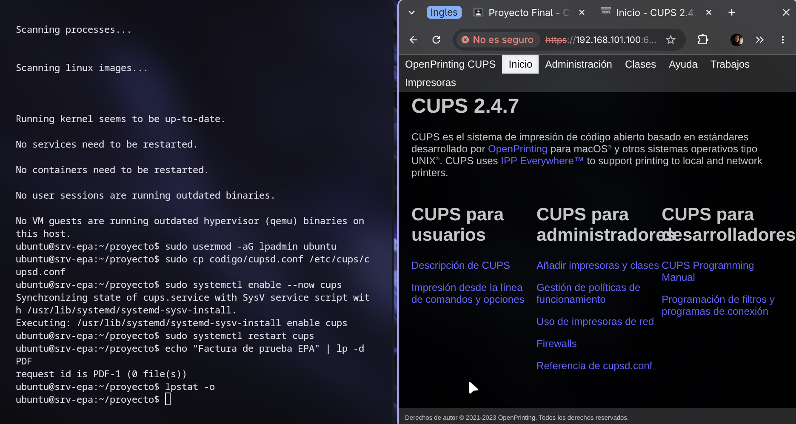

### Solución de problemas

- **No abre la web 631:** confirmar `Listen 0.0.0.0:631` y `sudo ufw allow 631/tcp`.
- **`forbidden` al administrar:** el usuario debe estar en el grupo `lpadmin`.

---

## 5. Samba — Compartición para Windows/Mac

**Objetivo:** carpeta compartida para el área administrativa (Windows/Mac).

### Servidor

```bash
sudo apt install samba smbclient -y
sudo mkdir -p /srv/samba/epa
sudo chgrp sambashare /srv/samba/epa 2>/dev/null || sudo groupadd sambashare && sudo chgrp sambashare /srv/samba/epa
sudo chmod 2770 /srv/samba/epa
sudo cp codigo/smb.conf /etc/samba/smb.conf
# Crear un usuario Samba (debe existir como usuario del sistema):
sudo useradd -M -s /usr/sbin/nologin epauser 2>/dev/null; sudo smbpasswd -a epauser
sudo usermod -aG sambashare epauser
sudo systemctl enable --now smbd nmbd
```

[`codigo/smb.conf`](codigo/smb.conf) define el recurso `[epa]` en `/srv/samba/epa`,
escribible y restringido a usuarios válidos.

### Verificación

```bash
# Desde el servidor:
testparm                                   # valida la sintaxis de smb.conf
smbclient -L //192.168.101.100 -U epauser    # lista los recursos
smbclient //192.168.101.100/epa -U epauser   # entra al recurso
# Desde Windows: Explorador → \\192.168.101.100\epa
# Desde Mac: Finder → Cmd+K → smb://192.168.101.100/epa
```

**Evidencia:**

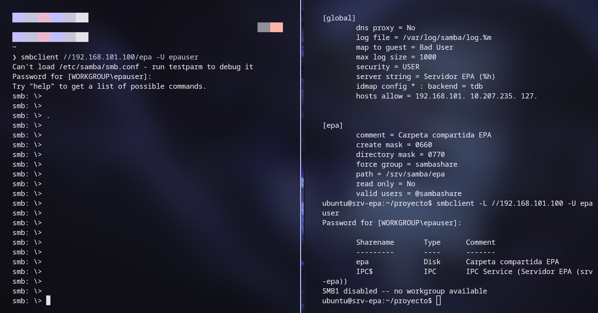

### Solución de problemas

- **`NT_STATUS_ACCESS_DENIED`:** el usuario no tiene clave Samba (`smbpasswd -a`) o no está en el grupo.
- **No aparece en red Windows:** abrir puertos `sudo ufw allow samba`.

---

## 6. Contenedores con Podman — App interna + Base de datos

**Objetivo:** levantar el portal EPA y su base de datos PostgreSQL como **contenedores**
con Podman, como entorno interno/dev en la VM servidor. Demuestra imágenes, volúmenes,
redes y orquestación multi-contenedor (Podman Compose). Es la misma app que luego se
publica a producción con Dokploy (§7).

### Instalar Podman

```bash
sudo apt install podman podman-compose -y   # en Ubuntu 24.04
podman --version
```

### La aplicación

El portal es una app **Node.js/Express** en [`codigo/sitio-web/`](codigo/sitio-web/):

- `/` → sitio institucional (en `public/index.html`)
- `/health` → estado del servicio
- `/info` → datos del sistema
- `/api/estado-bd` → verifica la conexión a PostgreSQL

El [`Containerfile`](codigo/sitio-web/Containerfile) construye su imagen (sirve tanto para
Podman como para Docker/Dokploy).

### Levantar con Podman Compose

```bash
cd /home/ubuntu/proyecto/codigo
podman-compose up -d          # construye la imagen y levanta app + PostgreSQL
podman-compose ps             # ambos contenedores en estado Up
```

[`codigo/podman-compose.yml`](codigo/podman-compose.yml) define:
- **app** (puerto `8080:3000`) conectada por la red `epa-net` a la base de datos.
- **db** PostgreSQL 16 con volumen `epa-datos` para **persistencia**.

### Verificación

```bash
podman ps                                  # epa-app y epa-db corriendo
podman volume ls                           # volumen epa-datos
podman network ls                          # red epa-net
curl http://192.168.101.100:8080/health      # {"estado":"saludable",...}
curl http://192.168.101.100:8080/api/estado-bd   # {"bd":"conectada",...}
podman-compose logs -f app                 # logs de la app
```

**Evidencia:**

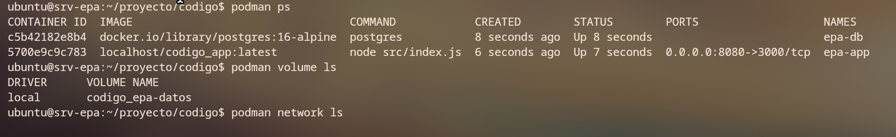

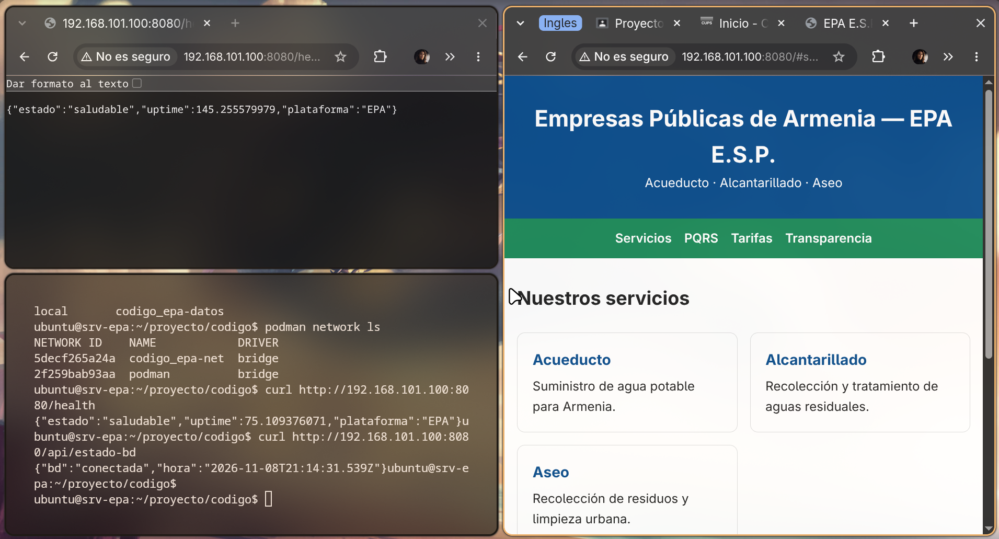

### Solución de problemas

- **`podman-compose: command not found`:** `sudo apt install podman-compose -y` (o `pip install podman-compose`).
- **No descarga la imagen de postgres:** usar el nombre completo `docker.io/library/postgres:16-alpine` (ya está en el compose).
- **La app no conecta a la BD:** ambos servicios deben estar en la red `epa-net` y la clave coincidir con la del `DATABASE_URL`.

---

## 7. Web pública + SSL con Dokploy

**Objetivo:** publicar el portal EPA en internet con HTTPS, desplegándolo desde Git, y
una base de datos PostgreSQL administrada. Es el entorno de **producción** (la misma app
de §6).

### Instalar Dokploy

```bash
# En la VM (requiere Docker, que el instalador configura):
curl -sSL https://dokploy.com/install.sh | sh
# Panel: http://192.168.101.100:3000
```

### Desplegar el sitio web

1. En el panel: **Create Project → Create Application**.
2. **Source:** repositorio Git con el proyecto; raíz de la app = `codigo/sitio-web/`.
3. **Build:** Nixpacks (autodetecta Node.js) o el `Containerfile` incluido.
4. **Domain:** `epa-armenia.duckdns.org` → habilitar **HTTPS / Let's Encrypt**.

> Para DNS dinámico: crear el subdominio gratis en [duckdns.org](https://www.duckdns.org)
> apuntando a la IP pública, y abrir/redirigir los puertos 80 y 443 en el router.

### Base de datos PostgreSQL

1. **Create → Database → PostgreSQL** en Dokploy.
2. Dokploy entrega host, puerto `5432`, usuario y clave.
3. Conectar la app por variable de entorno `DATABASE_URL` (ver [`codigo/sitio-web/.env.example`](codigo/sitio-web/.env.example)).

### Verificación

```bash
curl -I https://epa-armenia.duckdns.org      # HTTP/2 200 y certificado válido
docker ps                                     # contenedores de la app y la DB corriendo
```

**Evidencia:**

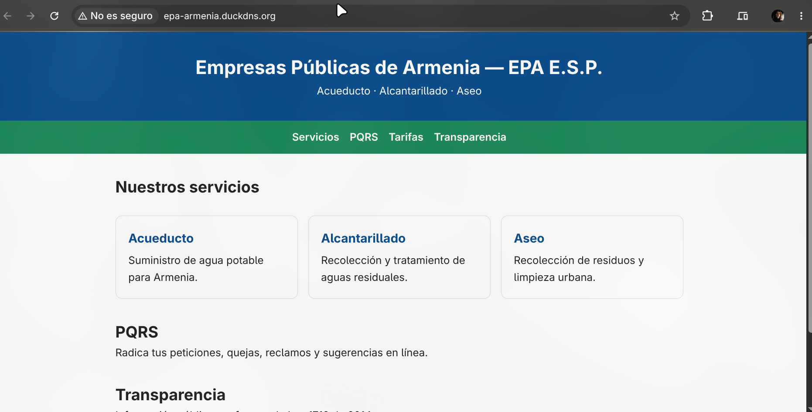

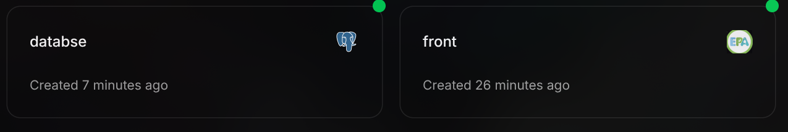

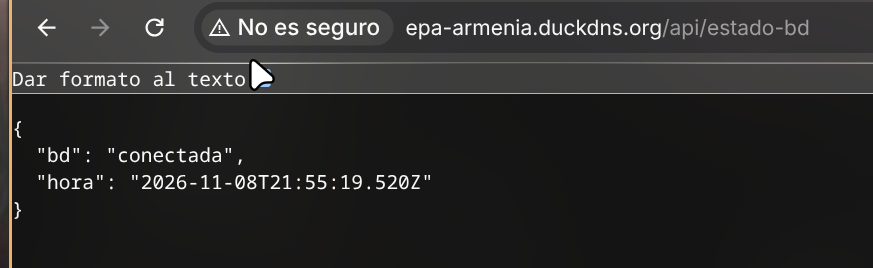

### Solución de problemas

- **Let's Encrypt falla:** el dominio debe resolver a la IP pública y los puertos 80/443 estar abiertos.
- **La app no conecta a la DB:** revisar `DATABASE_URL` y que la DB esté en el mismo proyecto Dokploy.

---

## 8. Extras opcionales (puntos adicionales)

- **Firewall (UFW):** aplicar [`codigo/firewall.sh`](codigo/firewall.sh) que abre solo los
  puertos de los servicios definidos.
- **Backup automático:** [`codigo/backup.sh`](codigo/backup.sh) + cron diario respalda
  `/srv/nfs/epa`, `/srv/samba/epa` y las configs.
- **Verificación integral:** [`codigo/verificar.sh`](codigo/verificar.sh) comprueba de una
  vez el estado de los servicios.

---

## 9. Resumen de verificación de servicios

| Servicio | Comando de prueba | Resultado esperado |
|---|---|---|
| NTP | `ntpq -p` | peers con `*` seleccionado |
| NFS | `df -h \| grep epa` (cliente) | montaje visible y escribible |
| NIS | `ypcat passwd` | lista de usuarios del dominio |
| CUPS | `lpstat -p` | impresora listada |
| Samba | `smbclient -L //192.168.101.100 -U epauser` | recurso `epa` visible |
| Podman | `podman ps` | `epa-app` y `epa-db` en Up |
| Web/SSL | `curl -I https://epa-armenia.duckdns.org` | `200` + certificado válido |
| PostgreSQL | `curl .../api/estado-bd` o `docker ps` | BD conectada / contenedor activo |
